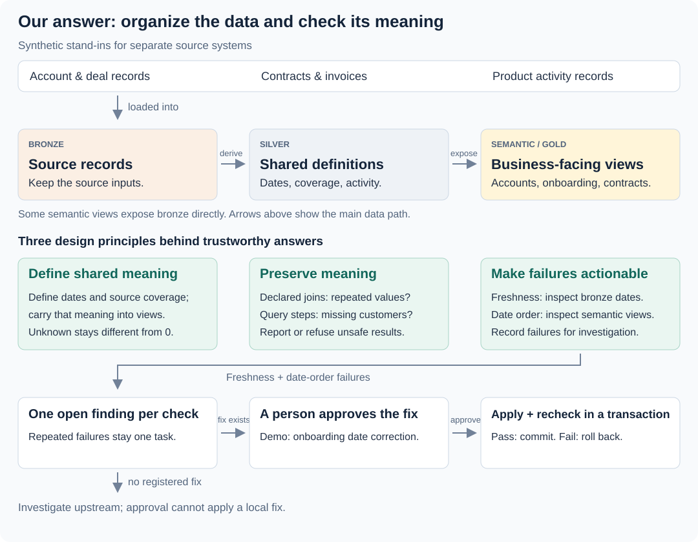
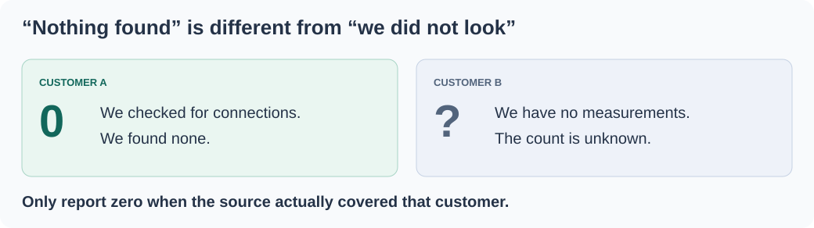
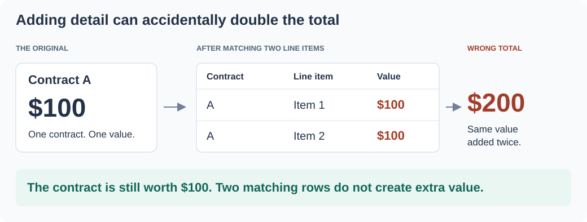

> **This is an example repo, not a library.** It exists to show one idea from an internal
> system, rebuilt over synthetic data so the idea can be read and run. It is not maintained
> as a dependency, not hardened for production, and the data in it is invented. Study the concepts;
> code reuse requires permission.

# Trustworthy warehouse



[View full-size overview](docs/warehouse-flow.svg)

## Situation

Customer information lived in separate source systems: account and deal records in one place, contracts and invoices in another, and product activity elsewhere. Each system described its own part of the business.

Answering a question such as “Which customers need help?” required bringing those records together. No single source could answer it on its own.

This example recreates that problem with synthetic customer, contract, usage, and invoice data.

## Complication

Combining records from those systems introduces assumptions about which records match, what dates mean, and who the data covers. A query can run successfully, return tidy rows, and still misrepresent the underlying facts:

- Joining extra detail can count the same contract value twice.
- A zero can hide the fact that a customer was never measured.
- Combining customer and activity records can remove the inactive customers we wanted to find.
- A recent load timestamp can hide a source that stopped producing new information.

These mistakes often survive basic checks. A doubled total can appear in one unique result row. A pipeline can finish successfully while copying old information. A calculation can also use a valid date that describes the wrong business event.

## Our Answer

Our approach is to **define what the data means, preserve that meaning when combining it, and make broken assumptions visible and actionable**. The engineering idea is to turn assumptions about keys, customer populations, measurement coverage, and dates into explicit definitions that code can check—even when the final rows look valid.

### Define meaning once, in shared layers

We reorganized the source information into three layers. PostgreSQL implements them as schemas, tables, and views:

| Layer | Responsibility | Examples in this repo |
| --- | --- | --- |
| **Bronze: source records** | Keep the source data available as inputs. | Accounts, contracts, invoices, activity, and measurement coverage. |
| **Silver: shared definitions** | Give records reusable definitions and summaries. | Current customers, original contract dates, measured accounts, and active-user counts. |
| **Gold / semantic: business-facing views** | Present data around the questions people ask. | Customer accounts, onboarding durations, contracts, and deals. |

The final layer is named `semantic` in the code; there is no separate `gold` schema. Some views expose bronze records directly when no intermediate transformation is needed.

Return to “Which customers need help?” Before interpreting a customer's activity, we need to know whether we measured it. A measured customer with no connections has a real zero. A customer outside the source's coverage has an unknown value. Treating both as zero would turn missing evidence into a business conclusion.



That distinction travels through the layers. `bronze.usage_coverage` supplies the coverage records. `silver.measured_accounts` identifies the measured customers, and `silver.account_connections` counts their connections. When `semantic.accounts` adds those counts to the full customer list, customers outside coverage retain `NULL`.

In the synthetic example, **276 apparent zeros become 6 measured zeros and 270 unknowns**. Another 24 customers have connections. Coverage is part of the model, rather than a warning every reader must remember to interpret. Replacing `NULL` with zero later would erase that meaning again.

Dates need shared definitions too. Silver exposes both the current contract's start date and the first contract date. A renewal does not change when the customer originally joined; a downstream calculation must choose the date that matches its question.

[Layer definitions and coverage](src/schema.sql) · [Zero-result check](src/measured.ts)

### Preserve meaning when combining data

Shared definitions are a starting point. The next question is whether a transformation preserves the people and values we intend to describe.

For the customer-help question, joining customers to active-user records with an `INNER JOIN` removes customers who have no active users. Those may be exactly the customers we wanted to find.

The example tracks customer IDs through each query step. A step intended to add information must preserve the customers without multiplying them. A filtering step may remove customers, but must state why. The check compares identities, not just counts: losing three customers and introducing three others does not pass because the total stayed the same. In the synthetic example, the broken query finds **38 customers where 81 qualify**, and the check identifies the 43 lost in the join.

The same principle applies to values. Consider a second question: “How much are our contracts worth?” One **$100** contract has two line items. Combining the contract with its items repeats the contract value in two rows.



In this simplified SQL illustration, the query returns one row for the contract—but its total is **$200**:

```sql
SELECT c.contract_id, SUM(c.value)
FROM contracts c
JOIN items i ON i.contract_id = c.contract_id
GROUP BY c.contract_id;
```

`GROUP BY` combines the rows after the value has been repeated. Checking that the result has one row per contract therefore misses the mistake.

To detect this, each table declares its key: the columns that uniquely identify a record. The checker evaluates each join separately. On the item side, joining by `contract_id` does not cover the item key, `item_id`, so one contract can match several items. Grouping by the missing item key would pin each group to one item; grouping only by the contract key does not.

The checker then traces which records travel with the repeated contract. Conceptually, it removes that join from the graph and marks the tables still connected on the contract side as repeated. This is why a later one-to-one join from items to item metadata cannot undo the original duplication: keys are evaluated per join, rather than pooled across the whole query.

That local reasoning makes the check inspectable, but conservative. In a cycle of joins, removing one edge may leave the tables connected through another path. The checker can therefore reject some safe queries rather than prove that all the constraints together prevent repetition.

The checker refuses the unsafe `SUM`; it does not rewrite SQL. A safer query calculates each total at its intended level before combining the results. This example checks a declared query structure rather than parsing SQL, so that description must match the query.

Together, these examples show why a plausible row count is insufficient: a transformation can lose the intended customers or repeat the value inside otherwise unique result rows.

[Customer identity checks](src/ledger.ts) · [Aggregate checker](src/grain.ts) · [Query examples](src/plans.ts)

### Make broken assumptions visible and actionable

Definitions and transformations also depend on assumptions about the source. A report about customers needing help is less useful if the activity source stopped changing, even while its copy job keeps succeeding. The freshness mechanism is illustrated separately with an invoice feed.

Copy yesterday's newspaper this morning. The copy is new; the news is not. Likewise, **load time** tells us when data was copied, while **content time** tells us when the source last produced relevant information.

Each source included in the freshness checks declares a meaningful content-date column, or explicitly records why it has none. At the example's fixed reference date, the invoice feed's load timestamp is **three hours old**, but its newest non-future invoice is **195 days old**. The check excludes a future-dated invoice that would otherwise make the source look current. Choosing the content timestamp explicitly avoids mistaking the pipeline's own load stamp for evidence that the source is healthy.

Date order provides another way to expose a broken assumption. The example's onboarding view initially uses the latest contract start rather than the first contract date. After a renewal, that can put onboarding before the supposed start of the customer relationship. A check reports these backwards durations instead of silently clamping them to zero. It detects an impossible ordering, not every possible misuse of dates.

Detection becomes useful when the finding is recorded and has a controlled path to resolution. Only **freshness and date-order checks** feed the example's task workflow; the coverage model and query checks above operate separately.

A database rule permits one open task per check, even when two runs fail concurrently. It uses a partial unique index, so a repeated failure stays one task. For onboarding, a person can approve a registered fix that changes the calculation to use the first contract date. Applying the fix and rerunning its check happen in one transaction: the change is saved only if the check passes; otherwise it rolls back. Findings without a registered fix require investigation upstream.

This connects a stated assumption to evidence, a finding, and a verified correction. Passing the check establishes that the finding is cleared; choosing the right fix still requires judgment.

[Freshness checks](src/freshness.ts) · [Date-order checks](src/durations.ts) · [Finding and approval workflow](src/janitor.ts)

## Why this matters to users

- **Act on more accurate totals and customer lists.** Checks help catch duplicated amounts and customers dropped by joins before those mistakes shape a report.
- **Distinguish “nothing happened” from “we cannot see it.”** Coverage-aware data separates measured zeros from unknowns, helping users avoid treating missing observations as inactivity.
- **Spend less time reconciling reports.** Shared tables define dates and metrics once, giving different reports a consistent foundation. A correction to that foundation benefits every report that uses it.
- **Build new reports on work already done.** Organized source data and reusable calculations reduce the need to reconstruct the same business logic. They also create a shared place to optimize calculations as reporting needs grow.
- **Recognize when the evidence is out of date.** Content-freshness checks expose stale source data even when copying it into the warehouse has succeeded.

## Explore the example

[Run it](docs/running.md) · [Implementation and tradeoffs](docs/mechanisms.md) · [Detailed limits](docs/limits.md)

Copyright © 2026 Geoffrey Lew. All rights reserved.
